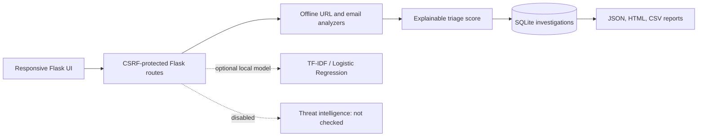

# PhishGuard AI

PhishGuard AI is a local-first, explainable phishing and social-engineering triage application. It analyzes URL structure and plain-text email, safely parses bounded `.eml` files, records investigation findings in SQLite, and exports case reports. It never visits submitted URLs, executes attachments, or sends input to an external reputation service.

> **Important:** Findings are indicators for human review, not proof of malicious intent. The application does not include user authentication and is intended for local use only.

## Architecture



Flask application factory and blueprints are used with SQLAlchemy and Flask-Migrate. The optional URL classifier is loaded only from a local artifact; without one, analysis continues in rules-only mode. No external services or API keys are required.

## Features and limitations

- URL structural checks: scheme, host/IP, IDN punycode, credentials, subdomain count, URL length, redirect-like parameters, and account-related wording. There are no DNS lookups or HTTP requests.
- Email patterns for urgency, credential/code requests, payment diversion, secrecy, and account threats; embedded URLs are analyzed offline.
- EML parsing uses Python's email package, analyzes plain text only, and reports attachment metadata without opening attachments.
- Authentication results distinguish absent, contradictory, and reported outcomes, but supplied header text is not independently verified.
- Risk score is 0–100, deterministic, and uses the maximum severity within each evidence category to limit repeated contributions. Initial thresholds are triage settings, not validated universal boundaries. This is not a calibrated probability.
- Cases retain findings, score, one-way SHA-256 input fingerprint, analyst status, and notes—not submitted URL or email body.
- Optional ML training and evaluation scripts operate on a user-provided licensed dataset. No dataset, pretrained artifact, or performance claim is bundled.
- Threat-intelligence provider integrations are not implemented. Status is “not checked,” never “clean.”

## Folder structure

```text
app/
  __init__.py, extensions.py, models.py, routes.py
  services/       # URL/email/EML/authentication/scoring/ML/report services
  templates/      # Responsive HTML pages
  static/         # Local CSS
ml/               # Reproducible training and evaluation scripts
tests/            # Pytest suite using synthetic inputs and in-memory SQLite
docs/             # Architecture, threat model, API, testing, privacy, demo
instance/         # Local database and optional ignored model artifacts
```

## Windows 11 setup

Python 3.11+ is recommended. Open PowerShell in this folder:

```powershell
py -3.11 -m venv .venv
.\.venv\Scripts\Activate.ps1
python -m pip install --upgrade pip
python -m pip install -r requirements-dev.txt
Copy-Item .env.example .env
python run.py
```

Open `http://127.0.0.1:5000`. The app initializes the SQLite database on first run. Flask debug mode is disabled by default. The `.env` file is not loaded automatically by this starter; set environment variables in PowerShell before running:

```powershell
$env:SECRET_KEY = "replace-with-a-random-secret"
$env:DATABASE_URL = "sqlite:///phishguard.sqlite"
python run.py
```

For a production deployment use a production WSGI server, a strong secret, HTTPS, `COOKIE_SECURE=true`, an externally managed rate-limit backend, backups, retention controls, and authentication/authorization before exposing the application to other users. This codebase does not implement authentication and must not be exposed to an untrusted network.

## Configuration

See `.env.example`. `DATABASE_URL` can be changed to a compatible SQLAlchemy PostgreSQL URL when the corresponding driver is added and installed. `SECRET_KEY` should be a unique random value. Set `COOKIE_SECURE=true` only when serving over HTTPS. Optional `PHISHGUARD_MODEL_PATH` points to a local trusted joblib model artifact.

## Analysis and case management

Dashboard: `/`; URL and email forms: `/analyze/url`, `/analyze/email`; EML upload: `/analyze/eml`; case list and detail: `/cases`; analytics: `/analytics`; exports: `/reports`; settings: `/settings`; health: `/health`.

Status changes are human analyst labels. Automated results do not mark cases confirmed malicious or benign. The model status remains “Not trained” unless a local artifact is available.

## ML training and evaluation

There is no dataset bundled. Use a legally usable CSV with `url,label` columns, document source/license/date, and inspect whether its collection and use are suitable. Training performs duplicate removal and a fixed-seed stratified random holdout; near duplicates and time-based drift may still affect results.

```powershell
python ml/train.py path\to\licensed_urls.csv --source "Citation; license URL; collection date"
python ml/evaluate.py instance\url_model.joblib path\to\held_out_urls.csv
```

Metrics are generated from the supplied data. Do not describe dataset results as real-world detection rates. Joblib artifacts can execute code when loaded; use only trusted artifacts. Details: [ml/README.md](ml/README.md).

## Testing

```powershell
python -m pytest
```

Tests use synthetic data and do not require API credentials or live URLs. See [docs/TESTING.md](docs/TESTING.md).

## Safe demonstrations

Run examples from [docs/DEMO_SCRIPT.md](docs/DEMO_SCRIPT.md). They use reserved/synthetic data. Do not use live malicious links or private messages for a demonstration.

## Security and privacy

See [docs/THREAT_MODEL.md](docs/THREAT_MODEL.md) and [docs/PRIVACY.md](docs/PRIVACY.md). No DNS or web lookup is performed. Raw input is not persisted; case notes and the input fingerprint remain in SQLite. EML HTML parts are not rendered. Spreadsheet exports guard formula prefixes.

## Screenshots and roadmap

Screenshots are intentionally not fabricated; capture them from a locally running instance if desired. A license is not included until dataset provenance and all bundled component licensing are reviewed. Potential follow-up work: authentication/roles, verified provider integrations with explicit consent, retention controls, time-based ML evaluation, migrations, and deployment hardening.

## License and attribution

No dataset is bundled. No project license is included yet; select one after reviewing dependencies and any future dataset/model provenance.
