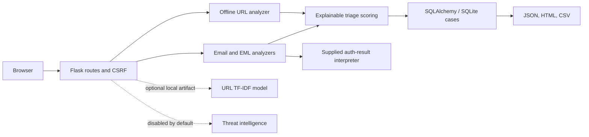

# Architecture

The application factory in `app/__init__.py` configures extensions and security headers. Route handlers use services for parsing, analysis, scoring, and exports. The default database is SQLite under `instance/`. Submitted indicators and message bodies are never persisted; case records contain a one-way SHA-256 fingerprint, findings, score, model-independent metadata, status, and analyst notes.

External reputation lookups are deliberately not implemented or enabled. The current intelligence status is always “not checked”; it must not be interpreted as a clean result. An optional local URL model can be loaded from a configured artifact path. If absent, the product remains rules-only.
